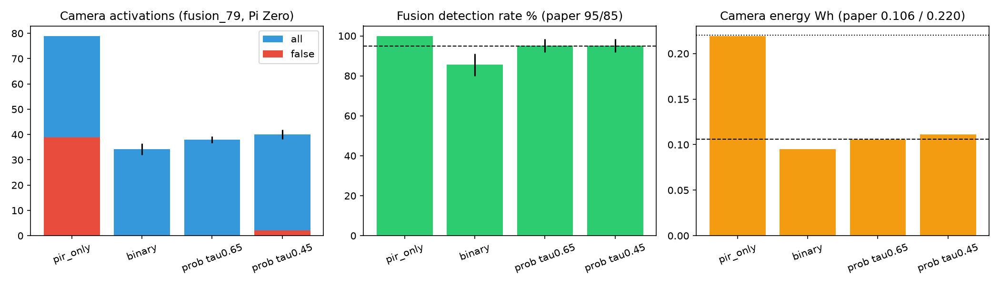

# How to read this report {.unnumbered}

This report covers the work done so far on turning NETRA's fixed sensor-fusion rule into a learned
policy. The work so far is a simulator, a baseline, an RL environment and short training checks.
It explains how each new file works, what the results are, and what is still open.
Every number comes from the code, the result files in `results/`, the NETRA paper
(arXiv 2605.08246v1) or the PhD research summary (`PhD.pdf`). Where a value is not from the paper,
it is labelled with the same provenance tags the code uses:

| Tag | Meaning |
|----|----------|
| **[PAPER]** | Taken directly from arXiv 2605.08246v1 (section/table cited) |
| **[DERIVED]** | Computed exactly from paper numbers (e.g. confusion matrices from precision/recall tables) |
| **[CALIBRATED]** | Synthetic distribution tuned so the simulator reproduces a paper table |
| **[DATASHEET]** | Semtech SX1276/77/78 datasheet typical value |
| **[ASSUMED]** | A modelling choice the paper does not specify (e.g. λ = 0.5, fixed SF9) |
| **[SYNTHETIC]** | Not in the paper at all (battery, RSSI, sleep power…). Results depend on it. |

Project root on your PC: `D:\netra me` (with a space). Box working copy: `/workspace/netra/code/`.

# 1. Executive summary

* **Goal.** Replace NETRA's hand-tuned rule (P = 0.4·PIR + 0.6·P_dist, camera/alert if P ≥ 0.65,
  fixed radio settings) with a DQN policy. The policy jointly chooses camera use, transmit/wait,
  LoRa spreading factor and gateway, and treats a missed intrusion as categorically worse than a false alarm.
* **Starting point (before 30 Sep 2026).** The project had a 500-row toy sensor dataset, EDA
  plots and three toy "agent" scripts. The `env/` folder was empty. There was no Gym environment, no DQN and
  no real field data.
* **Document review.** Cross-checking the paper against the PhD summary found several
  discrepancies in the summary. The most important: the paper reports **0% false alarms**, not 8.8%.
  The 8.8% is the share of 113 events that were confirmed threats. So a DQN cannot win on false alarms. Its
  gains have to come from **energy, SF adaptation and robustness**.
* **Built so far (7 new code files + 2 notes files):**
  1. `data/netra_simulator.py`: a seeded, paper-calibrated per-event simulator (sensors, vision
     confusion, power/solar, LoRa airtime/energy/delivery).
  2. `agent/fixed_rule_baseline.py` and `agent/run_baseline_eval.py`: the paper's Algorithms 1 + 2 as a
     baseline, plus a 200-seed Monte-Carlo evaluation that checks the simulator against the paper.
  3. `env/netra_gym_env.py`: a Gymnasium environment (15-value observation, 42 discrete actions,
     PhD reward plus battery terms, optional Lagrangian / lexicographic reward modes).
  4. `agent/env_policies.py`, `agent/env_smoke_test.py`, `agent/dqn_sanity_run.py`: the baseline and random
     policies inside the env, env checks, and a short Stable-Baselines3 DQN run.
* **Key results.** On the `fusion_79` scenario the simulator matches the paper's fusion tables:
  95.1% probabilistic-fusion detection, 0 false triggers at τ = 0.65, ≈2 at τ = 0.45, 51.9% camera-energy
  saving, and vision F1 within 0.3 points. In the environment (Pi Zero, 50 one-day episodes, 1.5–3 km links),
  the paper rule with SF9 scores return −0.8 and 53% detection. A 5 000-step DQN reaches
  return ≈ 10–13 and ≈ 70–76% detection with ≈ 0.3 false alarms per day. The DQN is not converged and sleeps too much.
* **Not done yet.** Full DQN training (1–5 M steps), the risk-sensitive reward comparison, multi-seed
  evaluation with CIs, TFLite INT8 export and on-device timing, a CUDA PyTorch install, real data.
* **State of `D:\netra me`.** A read-only check on 8 Oct 2026 found **no changes since 30 Sep 2026**
  (details in §12).

# 2. Project goal and research question

From `PhD.pdf` (research summary "Adaptive Safety-Critical IoT Detection via Deep Reinforcement Learning"):

| Item | PhD proposal |
|---|---|
| Legacy rule | P_intrusion = 0.4·P_PIR + 0.6·P_dist, alert if ≥ τ_c = 0.65; SF and camera "by fixed thresholds" |
| State s ∈ R⁵ | PIR, ultrasonic distance, YOLOv5 confidence, battery level, LoRa RSSI |
| Actions | SF7–SF12 · transmit now / wait · activate camera · relay to which gateway |
| Reward | +10 correct detection, −5 false alarm, −2·E_transmit, −8 missed intrusion |
| Network | 3-layer MLP 128 → 64 → \|A\|, trained with Stable-Baselines3 on GPU (RTX 5070 Ti) |
| Deployment | 8-bit TensorFlow Lite on Raspberry Pi Zero 2W (< 512 MB RAM) |
| Research question | How to shape the reward when a miss is *categorically* worse than a false alarm: risk-sensitive RL, constrained MDPs, lexicographic rewards |
| Target venue | IEEE TNNLS or IEEE Internet of Things Journal |

**Implication for the research design.** The env has three reward modes so the research question
can be tested directly: a standard weighted sum, a Lagrangian (CMDP primal–dual) mode with a
miss-rate target, and a lexicographic scale-separation mode (§8.4).

# 3. Starting point: what existed before 30 Sep 2026

| File | What it did | Limitation |
|---|---|---|
| `data/simulate_sensors.py` → `data/sensor_data.csv` | 500 synthetic rows: PIR (0/1, p = 0.3), `ultrasonic_distance` U(0.5, 5) m, `time_of_day` 0–23, `label = PIR AND (dist < 2.5 m OR night)` | Distance model is not the paper's (the paper uses a *drop from a 12–15 m background* and rejects readings < 4 m). No vision, battery or RSSI. |
| `notebooks/explore_data.py` | 4 plots in `results/` (`event_distribution.png`, `pir_over_time.png`, `ultrasonic_distance_over_time.png`, `eda_summary.png`) | EDA of the toy data only |
| `agent/basic_rl_loop.py` | Picks a random threshold from {0.3…0.8} each step | No learning, label inside the state |
| `agent/state_aware_loop.py` | Hand rule `if pir and (dist<2.5 or night): 0.3 else 0.7` | Identical to the label rule, so it is trivially perfect |
| `agent/compare_agents.py` | Random (−35, unseeded) vs rule (+40) over 20 steps | Not a meaningful benchmark |
| `env/` | empty | No Gym env, no DQN, no real 113-event data |

`PROJECT_SUMMARY.md` (Ezra's own notes, 30 Sep 2026 21:39) describes this state. It still refers to the
old path `d:\netra\`. It also justifies the 2.5 m threshold with a broad-gauge clearance envelope. That
rationale does not match the paper's sensing model, which is why the new simulator replaces it.

# 4. Document review: findings and discrepancies

The PhD summary was cross-checked against the paper text (`paper.txt`). The table lists what should be
corrected in the PhD summary before it is sent anywhere.

| Topic | PhD summary says | Paper actually says | Consequence |
|---|---|---|---|
| False-alarm rate of fixed rule | 8.8% | **0%** false alarms (Tables III–V, Table X). 8.8% (10/113) is the share of the 113 raw events that ended as *confirmed threats*. | "DQN < 5% false alarms" is not an improvement. Gains must come from energy, SF adaptation and robustness. |
| Detection rate | 95% | 95% is the *fusion-stage* rate on 40 intrusions (38/40, Table IV). The Pi Zero end-to-end field figure is **70% (14/20)**, Pi 4 **95% (19/20)** (Table II). | The baseline numbers need platform and stage labels. |
| Hardware | Raspberry Pi Zero **2W** | Raspberry Pi Zero **W** (ARM11, 1 GHz, 512 MB) | Zero 2W timing has to be measured separately. |
| Latency | Pi Zero 4.2 s / Pi 4 6.5 s | **6.5 s Pi Zero / 2.4 s Pi 4** (Table II) | The PhD table is reversed/wrong. |
| Distance model | Raw distance (toy code used < 2.5 m) | Drop Δd = D_bg − D from a 12–15 m calibrated background; readings < 4 m or > 15 m and Δd ≤ 0 rejected (Alg. 1, eq. 3) | The simulator uses the paper model. |
| 113-event dataset | "calibrated from the 113-event field dataset", "published dataset" | 20 human intrusions + 93 false triggers, semi-outdoor, one week. **Not released.** | All training data is synthetic until the real log is obtained. |
| Battery / RSSI | Part of the state | Not measured. The rig ran from a 5 V 2.5 A supply "simulating solar-battery operation". | Battery and RSSI models are fully [SYNTHETIC]. |

**Internal inconsistencies in the paper itself:**

* 113 events (20 intrusions + 93 false) in §IV-A vs 79 events (40 + 39) in Tables III–V vs 97 events in Table X.
* Cost per km: \$247/km (abstract/conclusion), \$100/km (comparison table), \$20/km and \$100/km (Table II).
* Deployment length: "one week", "7 days" (Table X), "March 7–25, 2026" (≈18 days), and a "three-day autonomous deployment" in the conclusion.
* 62.8% of triggers removed by fusion (71/113) would mean 42 camera activations with only 20 intrusions,
  so ≥ 22 false activations. That contradicts "0 false triggers".

**Hardware caveats (worth verifying on the real board):**

* HC-SR04 is normally rated to about 4 m. The paper uses a 4–15 m window and 12–15 m background echoes.
* SX1278 is specified for the low band (up to ≈525 MHz). The 868 MHz part is the SX1276. The simulator uses SX1276 HF-band
  sensitivities.

# 5. System overview

{width=100%}

There are two evaluation paths:

1. **Offline (per-event) path:** `simulate()` → `fixed_rule_baseline.evaluate()` → `run_baseline_eval.py`.
   This validates the simulator against the paper on the paper's own scenarios.
2. **RL path:** `NetraEnv.reset()` calls `simulate()` with Poisson event counts → the agent acts at each
   event/heartbeat → `env_policies.run_policy()` collects episode statistics. The baseline's
   `algorithm2()` is reused inside `FixedRulePolicy`, so the RL comparison uses exactly the paper rule.

# 6. Code walkthrough

## 6.1 `data/netra_simulator.py` (618 lines, 31.5 kB)

**Purpose.** Generate one row per PIR-triggered motion event (plus optional "quiet" PIR = 0 samples)
with everything a baseline or agent needs: the sensor readings, the *counterfactual* vision output (what the
classifier would say if the camera were switched on), weather, temperature, synthetic battery and synthetic RSSI.
It depends only on numpy and pandas.

**Main objects**

| Object | Role |
|---|---|
| `PAPER` dict | Paper constants: w_PIR 0.4, w_dist 0.6, τ_c 0.65 (alt 0.45), D_MAX 1.5 m, valid window 4–15 m, D_bg 12–15 m, 5 calibration readings, τ_AI 0.50, τ_alert 0.60, priority thresholds 0.7/0.6/0.5, camera 2 W × 5 s, fusion runtime 0.18 s, temperature 18–32 °C, 343 m/s |
| `CONF_COUNTS_PI_ZERO`, `CONF_COUNTS_PI4` | Vision confusion matrices (rows = true class) |
| `PLATFORMS` | Per-platform power, inference time, panel, battery, confusion |
| `SCENARIOS` | `fusion_79`, `events_113`, `field_97` event counts |
| `SimConfig` (dataclass) | All tunable parameters; `resolved()` fills scenario defaults |
| `simulate(cfg) → SimResult` | Main generator: events DataFrame + 1-minute power grid |
| `lora_airtime_s`, `lora_tx_energy_j`, `lora_rx_energy_j`, `lora_delivery_prob`, `path_loss_db` | LoRa physics helpers (also used by the baseline and env) |
| `run_battery()` | Clamped battery integration on the grid |
| `main()` | CLI: writes `data/netra_sim_events.csv` (seed 42, 3 scenarios × 2 platforms = 578 rows) |

**Scenarios [PAPER counts]**

| Scenario | Intrusions | False PIR triggers | Source in paper |
|---|---|---|---|
| `fusion_79` | 40 human | 39 | Tables III–V |
| `events_113` | 20 human | 93 | §IV-A.1 |
| `field_97` | 42 human, 15 cow, 8 elephant, 12 obstacle | 20 | Table X |

**Generation pipeline inside `simulate()`**

```text
rng = default_rng(seed)
day_weather[d]  ~ Categorical(clear .6, light_rain .2, moderate_wind .2)     [SYNTHETIC probs]
D_bg_true       ~ U(12, 15) m                                                 [PAPER]
link_d          ~ U(link_distance_m)            (default 1000 m)              [SYNTHETIC]
events          = intrusions per class + n_false false triggers
                  (vegetation .5 / bird .25 / vehicle .25)  + n_quiet
event time      = random day + hour drawn from a per-source hour profile
                  (elephant night, cow/vehicle day, bird dawn/dusk, rest uniform)  [SYNTHETIC]
D_bg_est        = mean of 5 noisy readings of D_bg_true (noise sd 0.03 m)
power grid      : 1-min steps, net_Wh = (solar_W - idle_W) * dt
for each event:
    PIR = 1 (0 for 'quiet'; pir_miss_prob = 0 by default)
    target distance by ultrasonic mode (table below)
    distance = measure(target) ; delta_d = D_bg_est - distance
    vision:  intrusion  -> pred ~ confusion row, conf ~ Beta(correct|wrong)
             no object  -> 'background' (p=.85 Pi Zero/.90 Pi 4, conf U(0,.3))
                           else random class with conf ~ Beta(0.35, sd .10)
    RSSI = P_tx + 2*G_ant - [PL(link_d) + weather loss + shadowing]
    record battery-if-idle, solar/idle Wh since previous event, ...
```

**Ultrasonic modes [CALIBRATED].** The paper gives no Δd distribution. These modes were fit so the
fusion tables come out right.

| Source | Mode (probability) | Target distance → Δd |
|---|---|---|
| Intrusion | clear (0.85) | object at U(4.5, D_bg − 1.2) m → Δd ≥ 1.2 m |
| Intrusion | partial (0.10) | Δd ~ U(0.65, 0.95) m (grazing/far-edge echo) |
| Intrusion | miss (0.05) | half "too close" (U(1, 3.9) m, rejected), half echo misses (background) |
| Vegetation | clutter (0.10) | Δd ~ U(0.15, 0.55) m, else background |
| Bird | in beam (0.30) | U(0.3, 3.9) m → rejected (< 4 m), else background |
| Vehicle | beyond (0.50) | D_bg + U(0.5, 5) m → Δd < 0, rejected, else background |

About 5% of false triggers end up with 0.125 ≤ Δd < 0.625 m. They pass τ = 0.45 but not τ = 0.65,
which reproduces "2 false activations at 0.45, 0 at 0.65" (Table V).

**Vision model.**

* Pi 4 (YOLOv5s ONNX) confusion is uniquely determined by Table VII + "92% cows → human" [DERIVED].
* Pi Zero (MobileNet-SSD): the diagonal and the 28 elephant→cow / 26 cow→elephant errors are exact [DERIVED].
  The remaining 22 off-diagonal errors were allocated in one of the few ways consistent with all
  precisions/recalls [SYNTHETIC].
* Confidences are Beta draws parameterised by mean/sd via `beta_from_mean_sd()`:
  k = μ(1−μ)/σ² − 1, Beta(μk, (1−μ)k). Correct label μ = 0.82, σ = 0.07; wrong label 0.62/0.10. The
  0.82 was tuned so ≈39% of `field_97` events exceed 0.8 (Table X: 38/97) [CALIBRATED].

```python
# Pi Zero confusion counts (rows = true, cols = predicted), Table VI
CONF_COUNTS_PI_ZERO = {
    "human":    {"human": 47, "elephant": 0,  "cow": 0,  "obstacle": 3},
    "elephant": {"human": 3,  "elephant": 6,  "cow": 28, "obstacle": 12},
    "cow":      {"human": 3,  "elephant": 26, "cow": 18, "obstacle": 0},
    "obstacle": {"human": 1,  "elephant": 0,  "cow": 0,  "obstacle": 18},
}
```

**Energy and solar.**

| Quantity | Pi Zero | Pi 4 | Source |
|---|---|---|---|
| Idle power | 0.5 W | 2.7 W | [PAPER Table II] |
| Inference power / time | 2.5 W / 5.2 s | 7.5 W / 0.8 s | [PAPER Table II] |
| Inference energy increment (P_inf − P_idle)·t | 10.4 J | 3.84 J | [DERIVED] |
| Camera | 2 W × 5 s = 10 J | same | [PAPER §IV-C] |
| Solar panel | 10 W | 25 W | [PAPER Table II] |
| Battery capacity, start SoC | 40 Wh, 80% | 100 Wh, 80% | [SYNTHETIC] |

Solar power (06–18 h only) [SYNTHETIC shape]:

P_solar(h) = P_panel × 0.6 (derate) × 0.6 (canopy) × f_weather × sin(π(h − 6)/12),
with f_weather = 1.0 (clear) / 0.35 (light rain) / 0.95 (wind).

The canopy factor 0.6 was chosen so the Pi 4 runs a ≈6 Wh/day deficit, i.e. ≈14 days from 80% SoC. That
matches the paper's "14 days (solar-assisted)" [CALIBRATED]. The Pi Zero has a surplus (≈24 Wh harvest vs 12 Wh idle).

Temperature: T(h) = 25 + 7·sin(2π(h − 9)/24) °C, i.e. 18–32 °C [PAPER range, SYNTHETIC shape].
The optional speed-of-sound drift (v = 331.3 + 0.606·T) is **off** by default.

**LoRa model.** Airtime uses the Semtech SX127x formula [DATASHEET], with a 20 B payload, BW 125 kHz, CR 4/5,
8-symbol preamble, explicit header, CRC and LDRO for SF11–12:

```python
t_sym      = 2**sf / bw
t_preamble = (n_preamble + 4.25) * t_sym
n_payload  = 8 + max(ceil((8*PL - 4*SF + 28 + 16*CRC - 20*IH) / (4*(SF - 2*DE))) * (CR + 4), 0)
airtime    = t_preamble + n_payload * t_sym
E_tx       = airtime * I_tx(P_tx) * 3.3 V     # I_tx = 120 mA @ +20 dBm
E_rx(ACK)  = airtime(4 B) * 11.5 mA * 3.3 V
```

Link model [SYNTHETIC]:
PL(d) = 31.2 dB + 10·3.5·log10(d) + weather loss (1.5 dB rain) + N(0, 4 dB (+1 rain, +2 wind));
RSSI = P_tx + 2 × 2.15 dBi − PL. Per-attempt delivery is P = Φ((RSSI − S_SF)/3 dB), with S_SF = −123, −126, −129,
−132, −133, −136 dBm for SF7…SF12 [DATASHEET]. The noise floor (≈−117 dBm) is only used for the SNR column.

**Key `SimConfig` fields**

| Field | Default | Meaning |
|---|---|---|
| `scenario`, `platform`, `seed` | `fusion_79`, `pi_zero`, 42 | What to simulate |
| `intrusions`, `n_false`, `n_quiet` | from scenario, 0 quiet | Override counts (the env uses this) |
| `deployment_days`, `grid_step_s` | 7, 60 s | Horizon and power-grid resolution |
| `us_noise_sd_m`, `temperature_drift` | 0.03 m, False | Ultrasonic noise |
| `p_intr_clear`, `p_intr_partial`, … | 0.85, 0.10 | Ultrasonic intrusion modes |
| `false_mix`, `veg_clutter_p`, `bird_in_beam_p`, `vehicle_beyond_p` | 0.5/0.25/0.25, 0.10, 0.30, 0.50 | False-trigger model |
| `conf_correct`, `conf_wrong`, `conf_spurious`, `night_conf_penalty` | (0.82, .07), (0.62, .10), (0.35, .10), 0 | Vision confidence |
| `solar_derate`, `canopy_factor`, `battery_wh`, `battery_init_frac` | 0.6, 0.6, platform, 0.8 | Energy |
| `link_distance_m`, `path_loss_exp`, `antenna_gain_dbi`, `shadow_sd_db`, `tx_power_dbm` | (1000, 1000), 3.5, 2.15, 4.0, 20 | LoRa link |

**Output columns** include `t_s, day, hour, is_night, weather, temp_c, source, true_class,
is_intrusion, is_dangerous, us_mode, pir, d_bg_est_m, distance_m, delta_d_m, pred_label, pred_conf,
rssi_dbm, snr_db, path_loss_db, grid_step, solar_wh_since_prev, idle_wh_since_prev,
battery_wh_idle_only`. `true_class` and `us_mode` are ground truth and must never be shown to an agent.
`pred_label/pred_conf` should only be revealed after the camera is used.

## 6.2 `agent/fixed_rule_baseline.py` (290 lines, 15.0 kB)

**Purpose.** Implement the paper's legacy pipeline so every learned policy can be compared with it on identical events.

**Algorithm 1: camera activation [PAPER Alg. 1, eq. 3–5]** (`algorithm1()`):

```python
dd    = d_bg_est - D
valid = dd > 0 and 4.0 <= D <= 15.0
p_dist = min(dd / 1.5, 1) if valid else 0
p_intr = 0.4 * PIR + 0.6 * p_dist
camera_on = PIR == 1 and valid and p_intr >= tau_c      # tau_c = 0.65 (0.45 variant)
```

With PIR ∈ {0, 1} this is equivalent to: PIR = 1, 4 ≤ D ≤ 15 m and **Δd ≥ 0.625 m** (τ = 0.45 → Δd ≥ 0.125 m).
There are two reference methods: `pir_only` (camera on every PIR trigger) and `binary` (PIR AND U_t, where U_t is
**[ASSUMED]** to be Δd ≥ 1.0 m because the paper does not define it).

**Algorithm 2: classification + alert [PAPER Alg. 2, eq. 6–7]** (`algorithm2()`, `priority()`):

```python
if label == "background" or conf < 0.50:  drop                    # tau_AI
IPS = lam * conf + (1 - lam) * p_intr     # lam = 0.5 [ASSUMED]
if IPS < 0.60:                           drop                    # tau_alert
priority = critical if label in {human, elephant} and conf >= 0.7
           high     if label == obstacle           and conf >= 0.6
           medium   if label == cow                and conf >= 0.5   -> logged only
           low      otherwise                                         -> suppressed
critical/high -> LoRa with ACK, up to 3 attempts [3 ASSUMED]
```

`transmit_medium=True` also sends cattle alerts, because Table X counts cattle among transmitted alerts,
which contradicts eq. 7.

**LoRa (`lora_send()`).** Fixed **SF9** at +20 dBm [ASSUMED]. The paper calls SF "adaptive" but gives no rule.
Each attempt costs E_tx + E_rx(ACK) and airtime. Data and ACK each succeed with probability p. A failed
ACK triggers a 1 s back-off.

**Energy and latency accounting** (on top of idle power): ultrasonic ping 0.005 J [SYNTHETIC], camera 10 J,
inference 10.4 / 3.84 J, LoRa TX/RX. Latency = 0.18 s fusion [PAPER] + 1.0 s camera [SYNTHETIC] +
inference + 0.2 s processing [SYNTHETIC] + LoRa time.

**`evaluate(sim, cfg)`** walks the events in time order, advances the battery on the fine grid, applies
Alg. 1 → Alg. 2 → LoRa, and returns a metrics dict. The main metrics:

| Metric | Definition |
|---|---|
| `fusion_detection_rate` | true camera activations / intrusions (paper Tables III–IV metric) |
| `camera_energy_wh` | activations × 10 J |
| `dangerous_alert_rate` | dangerous intrusions (human/elephant/obstacle) with a transmitted alert / all dangerous |
| `false_alarm_rate` | false alerts / non-intrusions (paper definition) |
| `raw_trigger_reduction` | 1 − alerts / PIR events (the paper's "91.2%"-style metric) |
| `lora_delivery_rate`, `energy_per_alert_j`, `latency_mean_s` | link, energy and timing |
| `battery_min_frac`, `battery_end_frac`, `events_at_empty_battery` | synthetic battery |

## 6.3 `agent/run_baseline_eval.py` (234 lines, 14.2 kB)

**Purpose.** A Monte-Carlo evaluation over every scenario × platform × method (`pir_only`, `binary`,
`probabilistic τ = 0.65`, `probabilistic τ = 0.45`) for N seeds (default 200, ≈50 s on the box).

* `run()` simulates each seed and computes camera/action energy savings relative to PIR-only.
* `aggregate()` gives the mean/std per configuration → `results/baseline_metrics.csv`.
* An extra `field_97` "send medium" variant compares against Table X's 77 alerts.
* `validation()` and `classification_check()` hold 34 paper-vs-sim checks with tolerances → `results/baseline_validation.csv`.
* `classification_check()` samples 20 000 predictions per class from the confusion rows, reweights to the
  paper's test-set class counts and recomputes F1/accuracy.
* `lora_sf_table()` gives airtime, TX energy and per-attempt delivery vs SF at 1/1.5/2/3 km → `results/lora_sf_table.csv`.
* A plot → `results/baseline_eval.png`.

## 6.4 `env/netra_gym_env.py` (520 lines, 26.5 kB)

**Purpose.** A `gymnasium.Env` (`NetraEnv`, configured by `EnvConfig`) in which the agent replaces Algorithms 1 + 2 and
the fixed SF. It also gets a new **sleep/duty-cycle** action. The design is described in §8. Key methods:

| Method | What it does |
|---|---|
| `__init__` | Builds the action space (Discrete 2 × 7 × n_sleep × n_gw) and obs space (Box[−1, 1], 11 + n_gw + 3). Sets event rates from `ENV_PROFILES` or a simulator scenario. Sets camera/inference energy. |
| `encode_action` / `decode_action` | a = ((gw·n_sleep + sleep)·7 + tx)·2 + camera |
| `reset(seed)` | Updates λ (Lagrangian mode). Draws Poisson event counts for the episode and a random initial SoC U(0.5, 1). Calls `simulate()` with those counts and the 1.5–3 km link range. Rebuilds the solar series and daily weather from the simulator's grid. Opens the first epoch. |
| `_obs()` | Builds the 15-float observation (§8.1) |
| `_sample_rssi(t)` | Fresh RSSI per epoch and gateway using the simulator's path-loss and shadowing model |
| `_advance(to_t, asleep_until)` | Integrates the battery on the 1-min grid (sleep power while asleep, else idle). Returns True on brownout. |
| `_spend(J)` | Charges action energy |
| `_send(sf, gw)` | Up to 3 attempts with ACK, returns (delivered, energy) |
| `step(action)` | Camera sub-step, or event resolution + sleep + advance to the next event/heartbeat |
| `_finish()` | Combines the reward components according to `reward_mode`. Fills `info` (`reward_components`, `cost`, `episode_stats`). |
| `make_env(**kw)` | Convenience constructor |

`step()` in pseudocode:

```text
cam, tx, sleep, gw = decode(action)
if event epoch and stage == "sense" and cam == 1:
    spend camera (10 J) + inference; stage <- "classified"; reveal label/conf
    return (same event, now with vision features)
if event epoch:                                   # resolve the event
    if tx > 0: delivered, J = send(SF[tx], gw); spend J
    intrusion: +10 if delivered else -8 ; non-intrusion: -5 if delivered else 0
if sleep > 0:
    every event in [t, t + sleep + boot) is skipped; each intrusion = -8 (missed_asleep)
    integrate battery at sleep power; pay boot energy; next epoch = heartbeat at wake-up
else:
    skip PIR=0 / overlapping events (intrusions -> -8)
    next epoch = next PIR event if within heartbeat_min (30 min) else a heartbeat
    integrate battery at idle power up to that time
battery <= 0  -> brownout: -50, all remaining intrusions missed, terminated
soc shaping   -> -1 * max(0, 0.2 - SoC)/0.2
reward = combine(components, reward_mode)
```

## 6.5 `agent/env_policies.py` (96 lines, 4.2 kB)

* **`FixedRulePolicy`** expresses the paper rule as obs → action. On heartbeats (PIR = 0) it does nothing and
  never sleeps. On the sense stage it turns the camera on iff 0.4·PIR + 0.6·obs[1] ≥ τ_c. obs[1] is already
  0 when Alg. 1 would reject the reading, so this matches the offline baseline exactly for τ_c > 0.4.
  On the classified stage it decodes the label one-hot, calls the baseline's `algorithm2()`,
  and transmits at the configured SF (default 9) if the decision is "transmit".
* **`RandomPolicy`** samples uniformly from the 42 actions (seeded).
* **`run_policy(env, policy, n_episodes, seed)`** rolls out episodes with seeds `seed + ep` and returns
  `episode_stats` as a DataFrame.
* **`summarize(df, days)`** reports mean return, detection rate, share missed while asleep, false alarms
  per episode, false-alarm rate, alerts, delivery, energy per delivered alert, camera uses, sleep fraction,
  end/min SoC and brownouts.

## 6.6 `agent/env_smoke_test.py` (84 lines, 3.9 kB)

1. Runs `gymnasium.utils.env_checker.check_env` on 5 configurations: default, 2 gateways, Lagrangian,
   lexicographic, and 7-day episodes without time features. All pass.
2. Rolls out random, fixed rule SF9, fixed rule SF9 + send cattle and fixed rule SF12 + send cattle on both platforms
   (default 20 one-day episodes, seed 1000). Prints a summary table. `--out` saves it as CSV.

## 6.7 `agent/dqn_sanity_run.py` (71 lines, 3.3 kB)

A short SB3 DQN run to prove the stack trains end to end. **It is not full training.**

```python
model = DQN("MlpPolicy", Monitor(NetraEnv(cfg)),
            policy_kwargs=dict(net_arch=[128, 64]),     # PhD 128 -> 64 -> |A|
            learning_rate=5e-4, buffer_size=50_000, learning_starts=500,
            batch_size=64, gamma=0.99, train_freq=1, target_update_interval=500,
            exploration_fraction=0.5, exploration_final_eps=0.05, device="cpu")
model.learn(total_timesteps=5000)          # --steps
```

It then evaluates random, fixed rule SF9 and the greedy DQN on 10 episodes (seeds from 10 000). It saves the model
only with `--save`.

## 6.8 Notes files

`docs/SIMULATOR_NOTES.md` (provenance and validation summary) and `docs/ENV_NOTES.md` (env design, smoke-test and
DQN tables, next steps) are the short in-repo references. This report expands them.

# 7. Validation results (simulator + fixed-rule baseline)

Source: `results/baseline_validation.csv`, `results/baseline_eval_stdout.txt` (200 seeds, Pi Zero unless noted;
fixed SF9, λ = 0.5).

## 7.1 Reproduced paper numbers (`fusion_79` and vision)

| Check | Paper | Simulated (mean ± sd) | Within tol. |
|---|---|---|---|
| PIR-only camera activations / false | 79 / 39 | 79 / 39 (by construction) | ✓ |
| Binary fusion true detections (rate) | 34 (85%) | 34.22 ± 2.21 (85.6%) | ✓ |
| Binary fusion false triggers | 0 | 0 | ✓ |
| Prob. τ = 0.65 detection rate | 95.0% | 95.06 ± 3.29% | ✓ |
| Prob. τ = 0.65 activations / false | 38 / 0 | 38.02 ± 1.32 / 0 | ✓ |
| Prob. τ = 0.45 activations / false | 40 / 2 | 40.10 ± 1.89 / 2.04 ± 1.37 | ✓ |
| Camera energy PIR-only / τ = 0.65 | 0.220 / 0.106 Wh | 0.22 / 0.11 Wh | ✓ |
| Camera energy saving τ = 0.65 | 51.9% | 51.87 ± 1.67% | ✓ |
| End-to-end latency Pi Zero / Pi 4 | 6.5 / 2.4 s | 6.90 / 2.50 s | ✓ (tol. 0.5 s) |
| LoRa delivery at 1 km (SF9) | 100% | 100% | ✓ |
| Field-97 false-alarm rate | 0% | 0% | ✓ |
| Field-97 events with conf > 0.8 | 39.2% | 38.65 ± 4.23% | ✓ (tuned) |
| Vision F1, Pi Zero (human/elephant/cow/obstacle) | 90.4 / 14.8 / 38.7 / 69.2 | 90.4 / 14.9 / 38.8 / 69.5 | ✓ |
| Vision F1, Pi 4 (human/elephant/cow/obstacle) | 62.4 / 83.5 / 7.7 / 100 | 62.4 / 83.5 / 7.6 / 100 | ✓ |
| Vision overall accuracy Pi Zero / Pi 4 | 53.9 / 64.1% | 54.0 / 64.1% | ✓ |

## 7.2 Mismatches (deliberately not tuned away)

| Check | Paper | Simulated | Why it cannot match |
|---|---|---|---|
| 113 events: triggers removed by fusion | 62.8% | 83.28% | 42 activations with 20 intrusions ⇒ ≥ 22 false activations, which contradicts 0 false triggers |
| 113 events: confirmed alerts | 10 | 17.30 | 10/20 contradicts 95% fusion detection |
| 113 events: raw-trigger reduction | 91.2% | 84.69% | follows from the two rows above |
| Field-97 alerts transmitted (cattle sent) | 77 | 61.14 | 77/77 implies a perfect pipeline; the Pi Zero's Table VI (elephant recall 12%, cow 38%) rules that out |
| 20-intrusion field detection, Pi Zero | 70% (14/20) | 86.47% | lower than fusion (95%) × human recall (94%) × gating; not reproducible from the other Pi Zero tables |
| 20-intrusion field detection, Pi 4 | 95% (19/20) | 88.22% | within the 10-point tolerance |

## 7.3 Baseline summary across scenarios (mean of 200 seeds, prob. τ = 0.65, SF9)

| Scenario | Platform | Cam. act. | False act. | Fusion det. | Cam. energy saving | Alerts | Dangerous alert rate | J / alert | Latency (s) | Battery end |
|---------|-------|-----|-----|-----|------|-----|------|-----|-----|-----|
| fusion_79 | Pi Zero | 38.0 | 0 | 0.951 | 51.9% | 35.2 | 0.879 | 22.2 | 6.90 | 0.935 |
| fusion_79 | Pi 4 | 38.2 | 0 | 0.956 | 51.6% | 35.5 | 0.888 | 15.0 | 2.50 | 0.480 |
| events_113 | Pi Zero | 18.9 | 0 | 0.944 | 83.3% | 17.3 | 0.865 | 22.5 | 6.90 | 0.931 |
| events_113 | Pi 4 | 19.0 | 0 | 0.950 | 83.2% | 17.6 | 0.882 | 15.1 | 2.50 | 0.472 |
| field_97 | Pi Zero | 73.3 | 0 | 0.952 | 24.4% | 52.0 | 0.806 | 28.9 | 6.90 | 0.927 |
| field_97 | Pi 4 | 73.2 | 0 | 0.950 | 24.6% | 57.2 | 0.874 | 17.8 | 2.50 | 0.464 |

The false-alarm rate is 0.0 in every probabilistic-fusion row. Per-alert action energy is dominated by camera
(10 J) + inference (10.4 J Pi Zero / 3.84 J Pi 4). A LoRa packet costs only 22–522 mJ. Idle power is
12 Wh/day (Pi Zero) and 65 Wh/day (Pi 4), so per-event choices barely move the battery unless the policy can
also sleep or duty-cycle.

{width=100%}

## 7.4 Synthetic LoRa link table (`results/lora_sf_table.csv`, +20 dBm, clear weather)

| SF | Airtime (ms) | TX energy (mJ) | Sensitivity (dBm) | P(deliver) 1 km | 1.5 km | 2 km | 3 km |
|---|---|---|---|---|---|---|---|
| 7 | 56.6 | 22.4 | −123 | 0.987 | 0.839 | 0.545 | 0.134 |
| 8 | 102.9 | 40.8 | −126 | 0.998 | 0.942 | 0.768 | 0.298 |
| 9 | 185.3 | 73.4 | −129 | 1.000 | 0.986 | 0.903 | 0.536 |
| 10 | 370.7 | 146.8 | −132 | 1.000 | 0.998 | 0.972 | 0.745 |
| 11 | 741.4 | 293.6 | −133 | 1.000 | 0.999 | 0.982 | 0.806 |
| 12 | 1318.9 | 522.3 | −136 | 1.000 | 1.000 | 0.997 | 0.931 |

At the paper's 1 km every SF delivers ≈100%, so SF choice only has a trade-off beyond ≈1.5 km. That is why the
env defaults to 1.5–3 km links. All values in this table depend on the [SYNTHETIC] path-loss model.

# 8. Gym environment design and results

## 8.1 Time model and observation

The env is an **event-driven semi-MDP**. Decision epochs are (a) a PIR event while awake and (b) a heartbeat every
30 min without events and at every wake-up. An event has two sub-steps. In the *sense* stage the agent sees
PIR/distance. Choosing camera = on charges the camera/inference energy and re-presents the same event with the
vision label and confidence (*classified* stage). Choosing camera = off resolves the event immediately using
sensor evidence only.

| Index | Feature | Encoding |
|---|---|---|
| 0 | PIR | 0/1 |
| 1 | P_dist | min(Δd/1.5, 1); 0 if Alg. 1 would reject the reading |
| 2 | dist_valid | 1 if 4 ≤ D ≤ 15 m and Δd > 0 |
| 3 | Δd | clip(Δd/5 m, −1, 1) |
| 4 | vision confidence | 0 unless the camera ran on this event (and label ≠ background) |
| 5 | camera_used | stage flag |
| 6–9 | label one-hot | human, elephant, cow, obstacle |
| 10 | battery SoC | 0–1 |
| 11 | RSSI (gateway 0) | clip((RSSI + 140)/60, 0, 1) |
| 12–14 | sin(2πh/24), cos(2πh/24), solar fraction | `time_features=True` |

This is a superset of the PhD's 5-value state. All five values are present, plus validity/Δd (Alg. 1 is range-aware),
camera flag + label (confidence is meaningless without a label and only exists after the camera runs), time/solar
for battery planning, and one RSSI per gateway.

## 8.2 Action space (Discrete 42)

| Component | Options | Notes |
|---|---|---|
| camera | off, on | only acts in the *sense* stage of an event |
| tx | wait, SF7, SF8, SF9, SF10, SF11, SF12 | "wait" = do not send (no deferred queue yet) |
| sleep | 0, 15, 60 min | power-gates the Pi; events during sleep + boot are missed |
| gateway | 1 (default) | `n_gateways=2` → 84 actions and 16-dim obs |

Encoding: a = ((gw·3 + sleep)·7 + tx)·2 + camera. Use `env.encode_action()` / `env.decode_action()`.

## 8.3 Reward (defaults, all in `EnvConfig`)

| Term | Value | Source |
|---|---|---|
| Intrusion with a delivered alert | +10 | PhD |
| Delivered alert for a non-intrusion | −5 | PhD |
| Missed intrusion (not sent, not delivered, asleep, PIR = 0, or remaining after brownout) | −8 | PhD (extended) |
| Correct non-alert | 0 | — |
| Action energy | −2 × E_action / 20 J (camera + inference + LoRa TX/RX) | PhD "−2·E_tx", normalised [ASSUMED] |
| Battery-low shaping | −1 × max(0, 0.2 − SoC)/0.2 per epoch | [SYNTHETIC] |
| Brownout | −50, episode terminates | [SYNTHETIC] |
| Idle energy | −w_idle × E/1 Wh (off, w_idle = 0) | optional |

Options: `energy_tx_only=True` (the literal PhD transmit-only energy term), `energy_include_boot`, and
`cow_is_intrusion` (default True, as in Table X; False makes cattle neutral as in eq. 7).
Sleep power is 0.05 W (Pi Zero) / 0.10 W (Pi 4), and boot is 25 s @ 1 W / 20 s @ 4 W. These assume an
external power-gating controller and are [SYNTHETIC]; the paper has no sleep mode.

## 8.4 Reward modes for the research question

| `reward_mode` | Formula | Interpretation |
|---|---|---|
| `standard` | sum of the terms above | PhD weighted reward |
| `lagrangian` | standard − λ · n_missed; at each reset λ ← clip(λ + 5·(miss_rate − 0.05), 0, 100) | CMDP primal–dual heuristic with a 5% miss-rate target; the reward is non-stationary on purpose |
| `lexicographic` | 10 × (miss + brownout terms) + 0.1 × (all other terms) | scale separation: "minimise misses first, then false alarms/energy" |

`info["cost"]` = misses in the step, for external constrained-RL code (e.g. a proper Lagrangian PPO).

## 8.5 Event profile and episode setup

Default `event_profile="mixed_113"` [SYNTHETIC combination]. It uses the paper's 113-event ratio (20 intrusions + 93 false
triggers per week) with the Table X intrusion class mix. That gives per-day Poisson rates of human 1.56, elephant 0.30,
cow 0.56, obstacle 0.45 (2.86 intrusions/day) and 13.3 false PIR triggers/day. Episodes are 1 day by default (7 for
"week"), with initial SoC U(0.5, 1.0) and link distance U(1.5, 3 km).

`field_97` rates (79% intrusions) are a poor training default. With them, "alert on every PIR trigger and never use the camera" is
near-optimal, and a 5 k-step DQN found exactly that (97% detection at 3 J/alert).

## 8.6 Smoke-test results (`results/env_smoke_test_day.csv`, 50 one-day episodes, seed 1000)

| Platform | Policy | Return | Detection | False alarms/ep | Delivery | J/alert | Camera uses/ep | Sleep frac. | SoC end |
|-------|------------------------|------|-------|-------|-------|------|------|------|------|
| Pi Zero | random | −28.2 | 0.230 | 2.70 | 0.869 | 228.9 | 2.06 | 0.753 | 0.958 |
| Pi Zero | fixed rule SF9 (paper) | −0.8 | 0.533 | 0 | 0.911 | 35.8 | 2.52 | 0 | 0.878 |
| Pi Zero | fixed rule SF9 + send cattle | 6.7 | 0.689 | 0 | 0.921 | 27.8 | 2.52 | 0 | 0.878 |
| Pi Zero | fixed rule SF12 + send cattle | 9.5 | 0.748 | 0 | 1.000 | 26.0 | 2.52 | 0 | 0.878 |
| Pi 4 | random | −24.0 | 0.274 | 2.58 | 0.892 | 698.1 | 1.96 | 0.753 | 0.921 |
| Pi 4 | fixed rule SF9 (paper) | 5.5 | 0.630 | 0 | 0.885 | 20.3 | 2.48 | 0 | 0.659 |
| Pi 4 | fixed rule SF9 + send cattle | 5.5 | 0.630 | 0 | 0.885 | 20.3 | 2.48 | 0 | 0.659 |
| Pi 4 | fixed rule SF12 + send cattle | 9.4 | 0.711 | 0 | 1.000 | 18.5 | 2.48 | 0 | 0.659 |

Week-long episodes (`results/env_smoke_test_week.csv`, 10 × 7 days): the Pi 4 fixed rule browns out in **4 of 10**
episodes (end SoC 0.34, min 0.19) because it never sleeps. The Pi Zero fixed rule ends at SoC 0.92. Random policies sleep ≈75%
of the time and waste energy on boots (J/alert includes boot energy).

Interpretation: with 1.5–3 km links the paper's fixed SF9 loses ≈9% of alerts. Simply switching to SF12 (and
sending cattle alerts) raises Pi Zero detection from 53% to 75% at lower energy per delivered alert. This is the kind of
headroom a learned policy can exploit.

## 8.7 DQN sanity runs (SB3 2.9.0, torch CPU, net [128, 64], Pi Zero, 1-day episodes)

| Run | Steps (time) | Train return 1st → last quarter | Eval return | Detection | FA / ep (= per day) | Sleep frac. |
|---|---|---|---|---|---|---|
| Box | 5 000 (8 s) | −34 → +3 | 10.3 | 0.695 | 0.30 | 0.25 |
| Box | 30 000 (55 s) | −27 → −1 | 6.0 | 0.610 | 0.17 | 0.39 |
| Ezra's PC (30 Sep, console output, not saved) | 5 000 | — | 13.2 | ≈0.76 | 0.3 | — |

Reference on the same 10 eval seeds (box): fixed rule SF9 −1.9 (detection 0.512), random −27.3.
These runs only show that env + SB3 + torch train end to end. They are **not converged and not tuned**. The DQN
already beats the paper rule on return and detection, but it sleeps far too much for a Pi Zero, which has no energy
deficit, and it introduces some false alarms (the fixed rule has none). The 30 k run scoring lower than the 5 k run
shows the instability expected from untuned DQN on a short budget.

Ezra's software stack (venv `D:\netra me\netra_env`): Python 3.13.6, stable-baselines3 2.9.0, gymnasium 1.3.0,
torch 2.14.0+cpu. The torch build is CPU-only, so the RTX 5070 Ti is currently unused.

# 9. How to run

All commands run **from the project root** `D:\netra me` with the venv interpreter. The `-B` flag avoids
writing `__pycache__`.

```bat
cd /d "D:\netra me"
REM regenerate data\netra_sim_events.csv
netra_env\Scripts\python.exe -B data\netra_simulator.py
REM single-seed demo of Algorithms 1 + 2
netra_env\Scripts\python.exe -B agent\fixed_rule_baseline.py
REM 200-seed baseline evaluation (~1 min), writes results\
netra_env\Scripts\python.exe -B agent\run_baseline_eval.py
netra_env\Scripts\python.exe -B agent\run_baseline_eval.py --seeds 50 --no-plot
REM env checks + random / fixed-rule rollouts (default 20 one-day episodes)
netra_env\Scripts\python.exe -B agent\env_smoke_test.py
netra_env\Scripts\python.exe -B agent\env_smoke_test.py --episodes 50 ^
    --out results\env_smoke_test_day.csv
netra_env\Scripts\python.exe -B agent\env_smoke_test.py --episodes 10 --days 7 ^
    --out results\env_smoke_test_week.csv
REM short DQN sanity run (5000 steps); optional longer run with a saved model
netra_env\Scripts\python.exe -B agent\dqn_sanity_run.py
netra_env\Scripts\python.exe -B agent\dqn_sanity_run.py --steps 20000 --platform pi4 ^
    --save results\dqn_sanity.zip
```

Using the env from your own code:

```python
import sys; sys.path.insert(0, "env")
from netra_gym_env import NetraEnv, EnvConfig
env = NetraEnv(EnvConfig(platform="pi_zero", episode_days=1, reward_mode="lagrangian"))
obs, info = env.reset(seed=0)
obs, r, terminated, truncated, info = env.step(env.encode_action(camera=1, tx=0))
```

**Troubleshooting**

| Symptom | Cause | Fix |
|---|---|---|
| `ModuleNotFoundError: No module named 'gymnasium'` when pressing Run in VS Code on `env\netra_gym_env.py` | VS Code is using the system Python, not the venv | *Python: Select Interpreter* → `D:\netra me\netra_env\Scripts\python.exe`, or run from a terminal with the full venv path as above |
| `ModuleNotFoundError: netra_simulator` / `fixed_rule_baseline` | Script launched from an unexpected place | Run from the project root. Each script adds `data/`, `agent/`, `env/` to `sys.path` relative to its own location. |
| Paths with a space | `D:\netra me` | Quote the path (`cd /d "D:\netra me"`) |
| DQN runs only on CPU | torch 2.14.0+cpu installed | Install a CUDA build of torch into the venv (next steps) |

# 10. Assumptions and limitations

| Assumption | Value | Tag | Effect |
|---|---|---|---|
| IPS mixing weight λ | 0.5 | [ASSUMED] | Changes Alg. 2 drops |
| Baseline SF | fixed SF9, +20 dBm, 3 attempts | [ASSUMED] | The paper says "adaptive" without a rule |
| Binary fusion U_t | Δd ≥ 1.0 m | [ASSUMED] | Only for the binary reference method |
| Ultrasonic Δd modes and false-trigger mix | §6.1 | [CALIBRATED] | Fit to aggregate tables, not to traces |
| Vision confidence shapes | Beta(0.82, .07)/(0.62, .10)/(0.35, .10) | [CALIBRATED] | Affects τ_AI / priority gating |
| Pi Zero residual confusion errors | 22 errors allocated | [SYNTHETIC] | Consistent with all P/R values |
| Battery | 40 / 100 Wh, start 80% (env: U(0.5, 1)) | [SYNTHETIC] | No battery data in the paper |
| Solar | derate 0.6 × canopy 0.6, weather factors | [SYNTHETIC / CALIBRATED to 14-day Pi 4 autonomy] | Drives energy trade-offs |
| Sleep / boot | 0.05 W / 25 s @ 1 W (Pi Zero), 0.10 W / 20 s @ 4 W (Pi 4) | [SYNTHETIC] | Needs an external power-gating controller |
| RSSI | log-distance n = 3.5, 4 dB shadowing, 3 dB fast fading, 1.5–3 km in env | [SYNTHETIC] | Determines the value of SF choice |
| LoRa radio | SX1276 HF sensitivities, 120 mA @ +20 dBm | [DATASHEET] | The paper names SX1278 at 868 MHz |
| Event rates | `mixed_113` | [SYNTHETIC combination of PAPER counts] | Training distribution |
| Hour-of-day profiles, weather probabilities | per source | [SYNTHETIC] | Night/day structure |

**Limitations.**

* There are no real sensor traces. The 113-event log is unreleased, so every distribution is fit to aggregate table values.
* The vision model is a confusion-matrix sampler. It has no image-level or night effects (the night penalty exists but is off).
* The env has no deferred-send queue ("wait" = never send), and no inter-node/gateway contention.
* DQN results are from a few thousand steps on 10 eval seeds. They are not evidence of a final improvement.

# 11. What is not done yet, and next steps

1. **`agent/train_dqn.py`** for full training: 1–5 M steps; `SubprocVecEnv` with 8–16 parallel envs;
   `EvalCallback` on fixed seeds; checkpoints under `results/`; comparison against FixedRulePolicy SF9 and SF12.
2. **Episode length / curricula:** 7-day episodes for battery learning (γ ≈ 0.995), and curricula over platform
   (Pi Zero surplus vs Pi 4 deficit), link distance and initial SoC.
3. **Hyper-parameter sweep:** lr 1e-4–5e-4, buffer 200 k–1 M, target update 1–5 k, exploration over 20–30%
   of steps. Also try Double DQN / QR-DQN (sb3-contrib) and action masking (many action parts are ignored per stage).
4. **Research question:** compare standard vs Lagrangian (sweep the miss-rate target) vs lexicographic reward modes;
   report miss rate against energy per alert (Pareto front).
5. **Evaluation:** ≥ 200 seeds with confidence intervals. Report detection, false-alarm rate, energy per alert,
   delivery, brownouts and SoC against both fixed-rule variants.
6. **Deployment:** export the Q-network PyTorch → ONNX → INT8 TFLite and measure inference time and memory on a
   Pi Zero 2W (and note that the paper's numbers are for a Pi Zero W).
7. **GPU:** install a CUDA build of torch into `netra_env` so the RTX 5070 Ti is used. Small MLPs may still be
   env-bound, so parallel envs matter more than the GPU.
8. **Data:** obtain the real 113-event log (and battery/RSSI logs, if any) from the NETRA authors, and re-calibrate the
   simulator against it.
9. **Fix the PhD summary's baseline numbers** (false-alarm rate 0% not 8.8%, platform-specific detection 70%/95%,
   latency 6.5 s/2.4 s, Pi Zero W vs 2W, dataset not released) and verify the HC-SR04 range and SX1278/SX1276 band on the hardware.

# 12. File inventory

## 12.1 New files (box `/workspace/netra/code/` ≡ `D:\netra me\`)

All 17 files below are **byte-identical** on the box and on D: (SHA-256 compared on 8 Oct 2026).

| Path | Size (bytes) | D: last write (30 Sep 2026, IST) | Purpose |
|---|---|---|---|
| `data/netra_simulator.py` | 31 471 | 22:14 | Paper-calibrated event simulator |
| `data/netra_sim_events.csv` | 120 623 | 22:16 | Seed 42, 3 scenarios × 2 platforms (578 rows) |
| `agent/fixed_rule_baseline.py` | 15 013 | 22:16 | Paper Alg. 1 + 2 baseline, `evaluate()` |
| `agent/run_baseline_eval.py` | 14 208 | 22:16 | 200-seed evaluation + validation |
| `env/netra_gym_env.py` | 26 478 | 22:32 | Gymnasium env `NetraEnv` |
| `agent/env_policies.py` | 4 214 | 22:29 | FixedRulePolicy, RandomPolicy, run/summarize |
| `agent/env_smoke_test.py` | 3 888 | 22:32 | check_env + policy rollouts |
| `agent/dqn_sanity_run.py` | 3 301 | 22:32 | Short SB3 DQN run |
| `docs/SIMULATOR_NOTES.md` | 7 300 | 22:18 | Simulator notes |
| `docs/ENV_NOTES.md` | 8 042 | 22:34 | Env notes |
| `results/baseline_metrics.csv` | 20 166 | 22:17 | Mean/std of all baseline metrics |
| `results/baseline_validation.csv` | 2 758 | 22:17 | Paper vs simulator checks |
| `results/lora_sf_table.csv` | 392 | 22:17 | Synthetic LoRa SF table |
| `results/baseline_eval.png` | 64 480 | 22:17 | Baseline plot |
| `results/baseline_eval_stdout.txt` | 8 607 | 22:17 | Console output of the 200-seed run |
| `results/env_smoke_test_day.csv` | 1 645 | 22:34 | 50 × 1-day smoke test |
| `results/env_smoke_test_week.csv` | 1 646 | 22:34 | 10 × 7-day smoke test |

## 12.2 Pre-existing files on `D:\netra me` (unchanged)

| Path | Size (bytes) | Last write (IST) |
|---|---|---|
| `data/simulate_sensors.py` | 1 463 | 13 Sep 2026 19:29 |
| `data/sensor_data.csv` | 6 299 | 6 Sep 2026 14:34 |
| `notebooks/explore_data.py` | 3 748 | 6 Sep 2026 14:35 |
| `agent/basic_rl_loop.py` | 1 803 | 24 Sep 2026 19:15 |
| `agent/state_aware_loop.py` | 2 896 | 24 Sep 2026 22:55 |
| `agent/compare_agents.py` | 2 147 | 24 Sep 2026 23:00 |
| `results/eda_summary.png`, `event_distribution.png`, `pir_over_time.png`, `ultrasonic_distance_over_time.png` | 818 580 / 55 102 / 417 355 / 524 068 | 6 Sep 2026 14:41 |
| `PROJECT_SUMMARY.md` | 10 844 | 30 Sep 2026 21:39 |
| `PhD.pdf` | 241 506 | 14 Aug 2026 11:03 |
| `2605.08246v1.pdf` | 24 433 333 | 19 Aug 2026 13:42 |

**Change check (8 Oct 2026).** A read-only recursive listing of `D:\netra me` (excluding the `netra_env` venv)
found no file modified after 30 Sep 2026 22:34 IST and no new files. The SHA-256 of every new file matches the box copy.

## 12.3 This report

`/workspace/netra/report/`: `NETRA_Progress_Report.md` (source), `NETRA_Progress_Report.pdf`,
`NETRA_Progress_Report.docx`, `img/architecture.png` (generated by `make_diagram.py`), `img/baseline_eval.png`.
